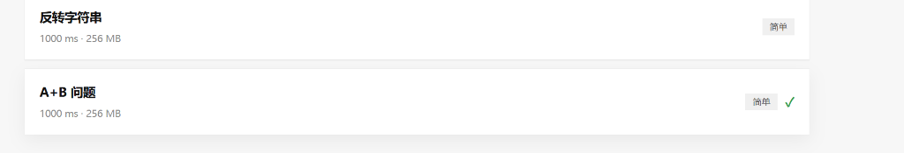
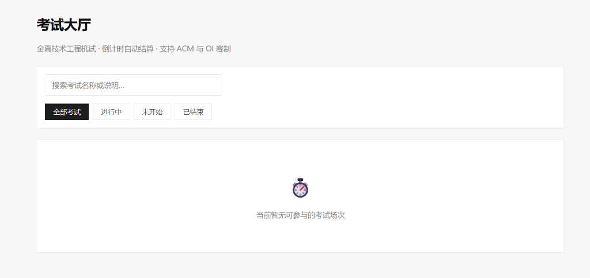
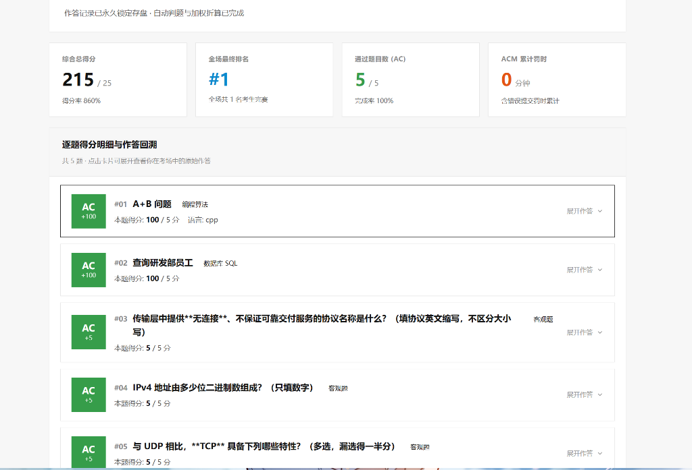
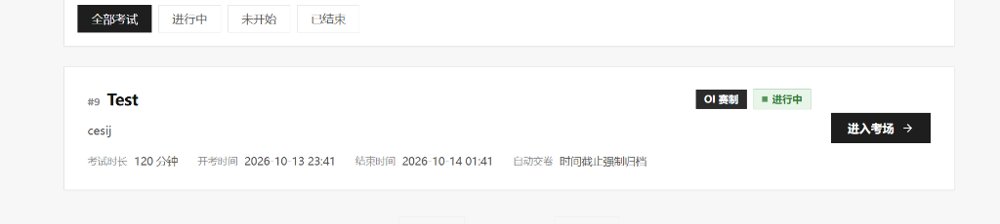
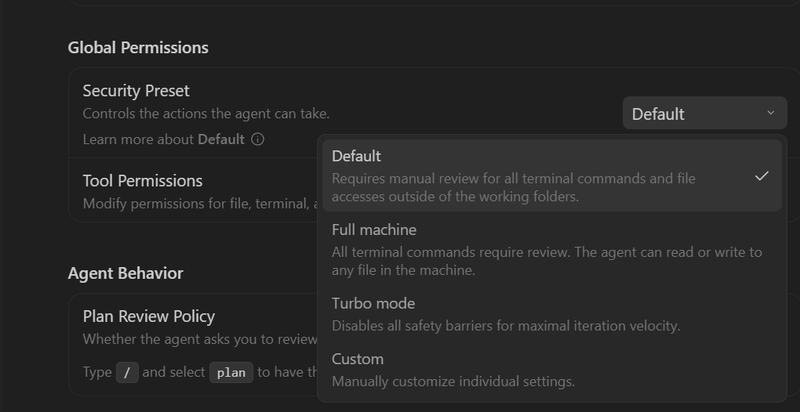

# KECE — 综合编程与全真技术技能评测平台

[](https://vuejs.org/)
[](https://spring.io/projects/spring-boot)
[](https://golang.org/)
[](https://www.mysql.com/)

> **全真技术工程机试与在线评测平台**，集 **算法 OJ**、**数据库 SQL OJ**、**客观题自动评测** 与 **全流程组卷考试/竞赛系统** 于一体。服务于企业技术招聘笔试、高校实验教学及专业刷题竞技场景。

---

## 📸 界面全景展示 (Interface Showcase)

KECE 采用**纯粹极简的硬朗直角（0-Radius）与 Bento Grid 工业美学**设计，摒弃多余拟物与圆角修饰，采用高对比度黑白灰、数码排盘以及标志性的**评测直角状态方块矩阵**。

### 1. 全真隔离考场工作台
* 左侧 36×36px 直角题号导轨，双栏分屏设计（左题面规格/右 Monaco 编辑器与直角字母选项矩阵）。
* 顶部配备等宽数码倒计时表盘、实时答题进度感知与切屏反作弊上报监控。



---

### 2. 考试归档战报与 Bento 四大指标方块
* 考卷提交后即刻生成永久锁定归档战报。顶部采用标志性 **四大指标 Bento 直角大方块**（综合总分、全场名次、AC 通过题数、ACM 罚时）。
* 下方聚合全场实时天梯榜，配备冠亚季军纯黑、深灰、中灰直角方块勋章。



---

### 3. 逐题 64×64px 评测状态方块与作答快照回溯
* 每道试题配备 **64×64px 硬朗直角评测状态方块**（`AC` 翡翠绿、`WA` 猩红、`未答` 石板灰高反差），直观呈现得分折算。
* 点击卡片即可丝滑展开**原始提交内容快照抽屉**，支持一键代码复制与回溯。



---

### 4. 考试大厅卡片与外部实时天梯榜
* 考试列表卡片清晰呈现赛制标记（ACM/OI）、起止时间及状态。
* 考生交卷后「进入考场」按钮自动**变灰禁用为 `[已交卷]`**，同步浮现 `[查看战报 →]`。
* 在考试卡片外部可直接点击 **`[实时排名]`**，原地呼出高反差 Bento 实时天梯榜弹窗，支持 10 秒静默轮询。



---

### 5. 题库中心与对齐规格排盘
* 算法编程、数据库 SQL、客观题三大独立练习模块，支持难度标签严格对齐与多语言快速筛选。



---

## ⚡ 核心产品特性

### 1. 三位一体评测引擎
- **算法 OJ**：
  - 支持 **C/C++**、**Java**、**Python** 等多主流语言。
  - 完整评测状态机（`AC` · `WA` · `TLE` · `MLE` · `RE` · `CE` · `SE`）。
- **数据库 SQL OJ**：
  - 原生支持 **MySQL 8.0** 方言，覆盖 `SELECT` 查询与 `DML` 数据修改题型。
  - **物理级判题强隔离**：每次评测在独立判题 MySQL 实例中生成临时库 `judge_{提交号}_{测试点号}`，跑完立即销毁 DROP，绝不污染业务数据。
  - 智能对拍算法：按列名严格/类型宽容度 + 浮点精度宽容度 + 可选严格行序智能比对。
- **客观题测评**：
  - 单选题、多选题（**漏选半分**算法）、填空题（精确/忽略大小写/正则匹配）。
  - 全面支持 Markdown 排版、语法高亮与 LaTeX 公式渲染。

### 2. 考试与竞赛全流程系统
- **双赛制支持**：
  - **ACM 赛制**：考试中代码题即时提交评测，天梯榜按 AC 题数与罚时（首 AC 分钟数 + 20 分钟错误惩罚）实时排序。
  - **OI 赛制**：考试期间只保存作答快照，交卷后由后台评测引擎批量入队判分，支持部分测试点加权分值折算。
- **题目快照组卷机制**：
  - 试卷创建时即刻**固化题面与分值快照**，题库后续修改不会影响历史考卷的公平性。
  - 评测机百分制原始得分自动无缝映射为试卷设定分值（$\text{score} = \text{round}(\frac{\text{raw} \times \text{snapshot}}{100})$）。
- **防作弊系统**：
  - 浏览器窗口切屏检测、次数记录与考场预警，交卷后记录归档于管理端。
- **防重入交卷保护**：
  - 考场交卷后永久锁定作答记录，考场入口安全阻断，考试大厅按钮置灰。

---

## 🛠️ 技术栈与架构

### 技术选型

| 架构层 | 核心技术选型 | 说明 |
| :--- | :--- | :--- |
| **前端 SPA** | **Vue 3** + **Vite** + **TypeScript** | 组合式 API + `<script setup>` |
| **代码编辑** | **Monaco Editor** (`@monaco-editor/vue`) | VS Code 同款内核代码编辑器 |
| **状态 & 路由** | **Pinia** + **Vue Router 4** | 集中状态管理与鉴权守卫 |
| **后端 API** | **Spring Boot 3** + **Java 17** | 模块化分层架构、统一响应封装 |
| **持久化层** | **MyBatis** + **MySQL 8.0** | 业务主库，事务级读写保障 |
| **缓存 & 队列** | **Redis 7** (Spring Data Redis) | 判题任务解耦队列与评测进度缓存 |
| **沙箱判题机** | **Go 1.22+** + **Docker Engine** | Cgroups v2 + Namespace 强隔离沙箱 |
| **数据库判题** | 独立 **MySQL 8.0 容器** (端口 3307) | 一次性临时库隔离运行 |

### 异步评测链路架构

```
┌─────────────┐       HTTPS / RESTful      ┌─────────────────────────┐
│  Vue 3 SPA  │ ─────────────────────────▶ │  Spring Boot 3 后端服务   │ ──▶ MySQL 8.0 (业务库 kece)
└─────────────┘                            │  (认证鉴权 / 组卷 / 归档)  │
       │                                   └────────────┬────────────┘
       │                                                │ 写入任务队列 (judge:queue / judge:sql:queue)
       │ 轮询状态 (1s)                                     ▼
       │                                   ┌─────────────────────────┐
       ▼                                   │   Redis 7 消息中间件     │
┌─────────────┐                            └────────────┬────────────┘
│ 获取最新结果 │ ◀───────────────────────────────────────┤ 拉取评测任务 (BRPOP)
└─────────────┘                                         ▼
                                           ┌─────────────────────────┐
                                           │     Go 判题机 Worker     │
                                           └───────┬───────────┬─────┘
                                                   │           │
                     代码编译运行 (Cgroups/Docker)  ▼           ▼ SQL 一次性临时库执行比对
                                         ┌────────────┐   ┌────────────────┐
                                         │ Docker 沙箱 │   │ 判题 MySQL 3307│
                                         └────────────┘   └────────────────┘
```

---

## 📁 项目目录结构

```
KECE/
├── frontend/               # 前端 Vue 3 + Vite 单页应用
│   ├── src/
│   │   ├── api/            # REST API 接口契约封装
│   │   ├── components/     # Monaco 编辑器、通用导航、消息弹窗
│   │   ├── router/         # 页面路由与权限导航守卫
│   │   ├── stores/         # Pinia 用户认证状态与考场上下文
│   │   ├── views/          # 考场工作台、战报页、题库列表、管理后台
│   │   └── style.css       # 0-Radius 极简硬朗直角设计系统规范
├── backend/                # 后端 Spring Boot 3 工程
│   ├── src/main/java/com/kece/
│   │   ├── admin/          # 管理控制台模块
│   │   ├── common/         # 统一响应包装、异常拦截、安全拦截器
│   │   ├── database/       # 数据库 SQL OJ 题库与提交管理
│   │   ├── exam/           # 考试场次、组卷快照、交卷评分、排名服务
│   │   ├── objective/      # 客观题题库与判题器
│   │   ├── question/       # 算法题目与测试用例管理
│   │   ├── submission/     # 代码提交管理与异步结果收集调度器
│   │   └── user/           # 用户认证、JWT 生成、权限管理
│   └── src/main/resources/
│       ├── db/migration/   # Flyway 数据库版本化迁移脚本
│       └── mapper/         # MyBatis SQL 映射文件
├── judger/                 # Go 语言实现的沙箱判题机服务
│   ├── cmd/judger/         # 判题机入口进程
│   └── internal/           # Redis 队列消费者、Docker 沙箱运行器、SQL 对拍器
├── docs/                   # 架构决策文档 (ADR) 与设计展示资产
│   └── images/             # 界面展示截图
└── deploy/                 # Docker Compose 配置与一键运维启动脚本
```

---

## 🚀 本地快速启动

### 前置环境需求
* **Node.js** 20+
* **Java** 17+ (推荐 Eclipse Temurin 或 OpenJDK)
* **Go** 1.22+
* **Docker Desktop** (用于拉起沙箱容器与测试数据库)
* **MySQL 8.0** (本机运行，端口 3306，数据库名 `kece`，密码 `kece123`)

---

### 一键协同启动（推荐）

项目在 `deploy/` 下提供了全自动化服务拉起脚本，会自动检查判题容器、编译判题机并启动前端、后端与 Worker 进程：

```bash
# Windows PowerShell
.\deploy\start.ps1

# Linux / macOS
chmod +x ./deploy/start.sh && ./deploy/start.sh
```

如需终止所有后台进程：
```bash
.\deploy\stop.ps1    # Linux: ./deploy/stop.sh
```

---

### 手动分步启动

#### 1. 启动辅助容器（Redis 与 独立判题库）
```bash
docker run -d --name kece-judge-mysql --restart unless-stopped \
  -p 3307:3306 -e MYSQL_ROOT_PASSWORD=judge123 mysql:8.0 \
  --character-set-server=utf8mb4 --collation-server=utf8mb4_unicode_ci

docker run -d --name kece-redis --restart unless-stopped -p 6379:6379 redis:7-alpine
```

#### 2. 启动后端 Spring Boot
```bash
cd backend
$env:SPRING_PROFILES_ACTIVE = "dev"   # Linux/macOS: export SPRING_PROFILES_ACTIVE=dev
.\mvnw.cmd spring-boot:run           # Linux/macOS: ./mvnw spring-boot:run
```
* **API 接口地址**：`http://localhost:8080/api/v1`
* **Swagger 交互文档**：`http://localhost:8080/api/v1/swagger-ui.html`
* 预置种子测试账号：
  * **管理员**：`admin` / `admin123`
  * **出题教师**：`teacher` / `teacher123`

#### 3. 启动前端 Vite 开发服务器
```bash
cd frontend
npm install
npm run dev
```
* 访问主站界面：`http://localhost:5173`

#### 4. 启动 Go 判题引擎
```bash
cd judger
go build -o judger.exe ./cmd/judger

# 启动判题引擎（Windows PowerShell）
$env:REDIS_ADDR = "127.0.0.1:6379"
$env:JUDGE_MYSQL_HOST = "127.0.0.1"
$env:JUDGE_MYSQL_PORT = "3307"
$env:JUDGE_MYSQL_USER = "root"
$env:JUDGE_MYSQL_PASSWORD = "judge123"
.\judger.exe
```

> **提示**：判题机首次运行会自动拉取 `gcc:13`、`eclipse-temurin:17-jdk`、`python:3.12-slim` 基础沙箱镜像。建议提前 `docker pull` 以加速初次运行。

---

## 📄 关联项目文档

* [需求文档 (PRD)](./需求文档.md) — 完整功能规划与用例说明
* [产品规格说明 (PRODUCT.md)](./PRODUCT.md) — 平台设计原则与技术指标
* [全局接口契约规范](./全局接口规范与公共约定.md) — REST 响应规范与状态机定义
* [工程实施计划 (WBS)](./开发计划.md) — 迭代拆解与架构决策记录

---

## 📜 许可证

私有项目，未经授权许可不得用于商业运营。
